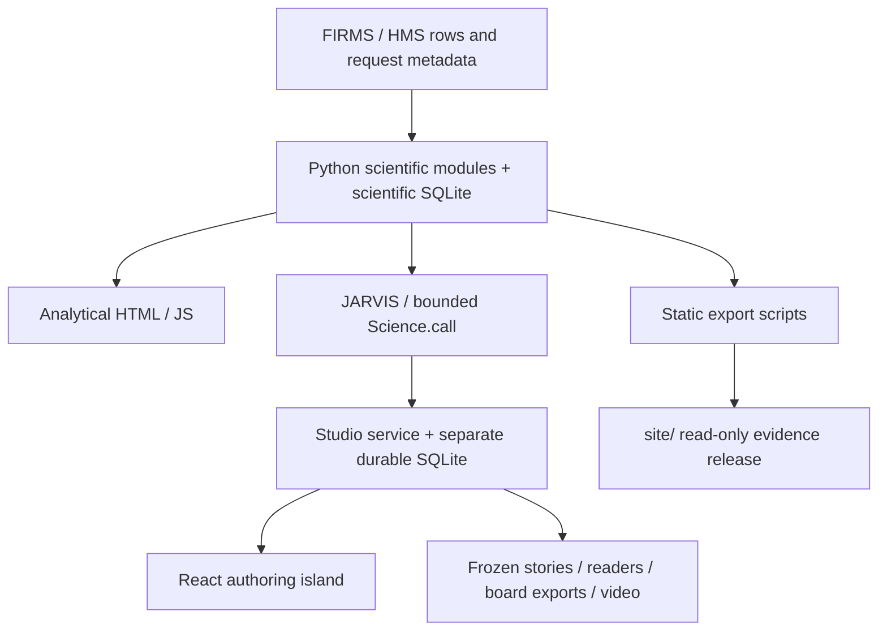

# Ignis-Atlassia / FireAtlas: LLM context entry point

Last source review: **2026-10-27**. Base commit: **3ce32242ff7ecc33f99ba337df24f0656fc4b8f6**.
This guide describes inspected source behavior. It is not a new runtime acceptance report.
Paths below are relative to the repository root; no personal absolute paths are needed.

## Start here

Ignis-Atlassia is a NASA Space Apps research prototype for comparing NASA FIRMS MODIS and Suomi-NPP VIIRS active-fire observations. It imports authentic rows into SQLite, assigns detection centroids to a common 1 km equal-area grid, computes UTC activity calendars, a held-out monthly comparability experiment, and descriptive research, and lets users freeze that evidence into private boards, stories, workflows, readers, and optional films.

The distribution name is Ignis-Atlassia; Python modules, command names, schemas, and many browser globals retain **fireatlas**. Older plans and reports describe earlier phases. When prose and implementation disagree, inspect current code and tests.

Investigation's More menu includes a standalone read-only Park example, available on both local and static sites. Its generated table and coordinate plots come from the published Park case; see the Studio frontend and delivery guides.

For a new task: read this page, load the relevant segment below, inspect its named source functions and tests, and check current Git status. Load the large source index only when locating a specific file or symbol.

## Segment map

| Segment | Context | Source authority |
| --- | --- | --- |
| Runtime, server composition, routes, storage boundaries | [01 Architecture](docs/context/01-architecture.md) | fireatlas/web.py, pyproject.toml |
| Acquisition, normalization, provenance, source completeness | [02 Ingestion](docs/context/02-ingestion.md) | core.py, archive.py, fetch.py, hms.py |
| Calendars, harmonization, research, replay, units | [03 Scientific analysis](docs/context/03-scientific-analysis.md) | aggregates.py, calibration.py, calendar_v2.py, research.py, replay.py |
| Native masks, independent review, reproducible science bundles | [04 Validation and evidence](docs/context/04-validation-evidence.md) | masks.py, validity.py, study.py, regional_study.py |
| Analytical HTML/CSS/JS and maps | [05 Analytical frontend](docs/context/05-analytical-frontend.md) | fireatlas/static/ |
| JARVIS, providers, receipts, HTTP, MCP | [06 Scientific assistant](docs/context/06-scientific-assistant.md) | fireatlas/assistant/ |
| Studio documents, transactions, commands, workflows, rooms, board exports | [07 Studio backend](docs/context/07-studio-backend.md) | fireatlas/studio/ |
| React board, inspector, state, collaboration, workflow editor | [08 Studio frontend](docs/context/08-studio-frontend.md) | studio-app/ |
| Stories, narration, readers, video engines and recovery | [09 Stories and rendering](docs/context/09-stories-rendering.md) | studio/story.py, studio-render/ |
| Static namespaces, builds, release workflow, test selection | [10 Delivery and verification](docs/context/10-delivery-verification.md) | scripts/, .github/workflows/, site/ |
| How to keep this context accurate; common change paths | [11 Maintenance](docs/context/11-maintenance.md) | this guide and scripts/update_codebase_context.py |
| Investigation whiteboard prototype and acceptance status | [12 Investigation prototype](docs/context/12-investigation-whiteboard-prototype.md) | Current implementation checkpoint plus historical design |

[Generated source/symbol index](docs/context/SOURCE_INDEX.md) · [Machine-readable inventory](docs/context/source-manifest.json)

## Architecture in one view



Science belongs to Python calculations. Assistant wording, map pixels, authored explanations, and generated video do not become measurement sources. Public research discovery and an opt-in budgeted specialist team use the shared assistant runtime; their source metadata and proposed tests remain separate from measured evidence. See the assistant and Studio guides.

## Contracts to preserve

1. A hotspot is a thermal observation. A cell-day is one occupied grid cell on one UTC date. Neither means a unique fire, burned area, perimeter, ignition, extinguishment, or forecast.
2. Missing evidence stays unknown/null. A complete export with zero detections does not prove a pass, clear sky, or no fire.
3. Raw calendar, replay, research, and harmonized activity have different filters and units. Retain method IDs, source versions, scope, provenance, and result hashes when moving results.
4. The raw calendar counts cell unions. Harmonized activity uses VIIRS-equivalent cell-days. FRP stays source-specific; do not add MODIS and VIIRS FRP as a harmonized total.
5. Scientific, assistant, native-mask, and durable Studio databases serve distinct purposes. Studio revisions must outlive expiring assistant sessions. Investigation can attach a drawing to a Studio document; its original browser-local scratch draft remains separate.
6. Saved evidence is immutable. Changing display selection is different from recalculating/refreezing a study.
7. Local Python authoring and the committed static website have different capabilities. Static pages cannot perform new private authoring or provider calls.
8. The landing globe/Earth experience has explicit preservation checks. Analytical UI refreshes must respect its boundary.
9. Ownership, origin checks, idempotency, revision conflicts, cancellation, and capability gates are functional contracts.
10. Synthetic fixtures remain isolated from authentic science. A passing recount/hash establishes reproducibility/integrity, not independent scientific approval.

## Run and orient

```bash
git status --short
bash scripts/run_website.sh
# Full core test command (optional assistant cases need the assistant runtime):
uv run python -m unittest discover -s tests
# Documentation-only freshness check:
python3 scripts/update_codebase_context.py --check
```

The application normally runs at http://127.0.0.1:8000/. Core Python requires 3.10+ and pyproj/pyshp. The pinned assistant extra requires Python 3.12+. The launcher uses an existing private assistant environment when configured. See the delivery guide before installing, building, exporting, or serving a fresh clone.

## Explore restoration

Explore's static route now uses an interactive raw archive viewer with map samples, source/month controls, monthly bars and a UTC day heat calendar. Exact counts come from a separate Python-generated `data/explore/` publication; old frozen evidence is preserved. See the frontend and delivery guides for lifecycle, supported scope and verification.

## Snapshot-specific findings

At review time, the worktree already had tracked deletions under fireatlas/static/studio-assets/, including its entry files, SDK, fonts, features, and asset manifest. They were preserved. An absent studio-manifest.json empties the server's Studio asset allowlist, so source availability does not prove that the local authoring UI can load. Recheck current status before diagnosing or rebuilding.

The inspected static evidence manifest is dated 2026-10-01; the separate analytical manifest is dated 2026-10-04. These are frozen data dates, not today's date. Local owner-supplied NASA inputs and databases are ignored by Git and need not exist in a clean clone. No private configuration values were read for this guide.

## Maintenance

After changing behavior, revise the affected segment guide, then regenerate and check the source index:

```bash
python3 scripts/update_codebase_context.py
python3 scripts/update_codebase_context.py --check
```

The checker detects inventory/hash/symbol drift; it does **not** certify that human-written explanations are semantically current. Record new verification honestly and remove superseded snapshot findings. [Maintenance procedure](docs/context/11-maintenance.md).

## Scientific readiness assessment

The integrated [monthly comparison](fireatlas/static/research.html) addresses a bounded part of the gaps with complete-month held-out and earlier-year experiments plus separate native-case diagnostics. Daily imputation, historical transfer and independent scientific approval remain withheld. [Current mentor criteria status](docs/MENTOR_CRITERIA_STATUS.md) records every concern and G01–G27; not all are fulfilled. Native/acquisition diagnostics are in Evidence; there is no separate Harmonize navigation segment. See the scientific, frontend and delivery guides for the new contracts.

The [mentor gap assessment](docs/MENTOR_GAP_ASSESSMENT.md) records a 2026-10-27 source/data audit, with [measured evidence](docs/mentor-gap-evidence.json). Read it before making claims about continuous historical harmonization, daily scaling accuracy, sensor-transition validation, or native agreement. It distinguishes implementation from scientific acceptance and lists unresolved work.

The mentor qualification successor uses isolated protocols/acquisition, monthly-v2 and separately gated daily research with immutable qualification releases. Read [execution and remaining gates](docs/qualification/IMPLEMENTATION.md); direct transfer evaluation is implemented, while qualified historical bridges and full-footprint opportunity remain unfinished. The owner-authorized AI experimental path binds a frozen audit receipt and reports authentic support failures without scientific admission. Original frozen releases and independent human scientific approval stay separate.

Native-angle/quality diagnostics now use an original-hash-bound sidecar and independent pixel-subset rematching inside Evidence/Investigate. Day/night is an explicit solar-angle diagnostic; full-cell opportunity and independent review remain open. See validation, frontend and delivery guides.

The isolated tiled opportunity successor adds original-page CMR receipts, original-file re-extraction, hash-bound independent review and area-weighted regional date/tile support. It retains companion-only and unsupported companion extents as unknown; publication retains pending states; no scientific admission is enabled. See [native opportunity execution](docs/qualification/OPPORTUNITY.md). The versioned historical-transfer admission successor and authentic boundaries/reviews remain open.

The [transfer-opportunity successor](docs/qualification/TRANSFER_OPPORTUNITY.md) wraps frozen count experiments with full-date regional/season/platform opportunity evidence and bound independent admission. Its local authentic collection results remain pending; historical deployment remains separate; the publisher and existing workspace controls now expose exact pending checks and downloads.

The isolated `historical_successor.py` readiness contract recounts candidate inputs and always withholds historical estimates; its transfer-input fingerprints do not prove original CSV files were reopened. The frozen legacy historical-record helper is not a deployment gate. See scientific analysis and qualification implementation guides.

Original transfer capture inputs can be checked against retained request CSVs, merged imports and first-owner database rows using the separate read-only provenance verifier; its local chain verification is not scientific or provider-origin approval. See ingestion and validation guides.
