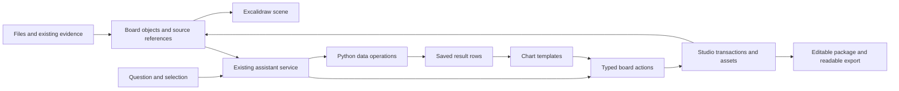

# Investigation Studio — working prototype context and implementation plan

**Reviewed:** 2026-11-08  
**Status:** core workflow implemented in source; complete on-screen demonstration, responsive acceptance and video remain unverified. The original roadmap below retains its dated baseline.  
**Audience:** the next implementation agent and the project owner.  
**Product decision:** make the existing Investigation whiteboard the main place to collect, inspect, compare and explain research. Keep the other pages as useful data tools.

[Project context](../../CODEBASE_CONTEXT.md) · [Studio frontend](08-studio-frontend.md) · [Studio backend](07-studio-backend.md) · [Scientific assistant](06-scientific-assistant.md) · [Delivery](10-delivery-verification.md)

## Current continuation state — 2026-11-10

The top companion now animates real edits: a camera pan, cursor approach, and progressive preview of the native scene objects. It commits one reversible update after checking the active board and scene. Automated regressions cover atomic placement, Stop, and concurrent board edits. The staged Vite entry and its 136 dependencies are served with matching hashes at the local URL and under a Pages-style project prefix.

A fresh local HTTP run used Ollama with `ignis-scientist:latest`. It returned a source-linked July 27 Park heatmap and a two-sentence note citing 348 detections across 288 grid cells, with acquisition times as the next check. The heatmap’s saved receipt hash matched the rendered-data response. This was a service-level test.

The public Pages deployment returned revision `3ce32242ff7ecc33f99ba337df24f0656fc4b8f6`; its Studio capability API returned HTTP 404. The local checkout’s Pages staging check also rejected the 1,908,509,930-byte publication against a 1,000,000,000-byte limit. Production authoring still requires the same-origin Studio service and a configured model. No publication was attempted.

## Previous continuation state — 2026-11-08

Current source implements named durable Excalidraw boards, CSV/PDF sources and inspection, the expandable top companion with action-bound cues, source-linked explanations and diagrams, exact Park charts, finding challenges, undo/redo, HTML/figure exports and native package restoration. The 2026-11-04 implementation inventory and planned gaps below describe the original baseline, not the current feature state. See [the frontend guide](08-studio-frontend.md) for active contracts.

On 2026-11-08 an isolated principal exercised the running local service at port 8161 against the authentic published Park CSV. The configured AI provider returned a July 27 explanation and diagram plan with exact MODIS 348, NOAA-20 1495 and NOAA-21 2073 values, plus the documented unavailable S-NPP state. A second actual provider request challenged a uniform-decline interpretation using July 26–27 MODIS and NOAA-21 records. Neither response reported unavailable AI wording. Provider prose is not independent scientific review.

The actual frontend shape helpers and pinned Excalidraw Node SDK generated editable objects from those responses. Service save/read, atomic AI-batch undo/redo and native package restoration preserved 104 elements, exact CSV bytes/hash, remapped original-object links and two conversation turns. A standalone report generated through the frontend report helper passed independent HTML parsing, exact embedded-CSV comparison, strict SVG XML parsing and SVG rasterization after namespace normalization. These are service and non-browser export checks, not UI acceptance.

Browser control remains prohibited following the earlier security-policy block. No alternative browser surface was used. Full on-screen import → ask → draw → inspect → challenge → reopen → export, the 320/390/768/1440-pixel layouts, actual editing-cursor positioning and a demonstration recording remain blocked. Do not describe the prototype as showcase-ready until those gates pass.

Follow-up readiness check on 2026-11-08 restarted the documented local service at port 8161 (HTTP 200; AI capability available), passed TypeScript, 114 focused frontend tests and 33 whiteboard-store/portability/Park-publication tests, and completed the staged Vite build plus whiteboard-only refresh. All 136 staged dependency hashes matched, the served entry loaded the namespace fix, the original Studio entry and eight pre-existing generated-asset deletions were retained, and the context index check passed. The existing standalone report again passed exact embedded-CSV and no-external-dependency checks; the actual package passed ZIP CRC with 104 editable objects, one CSV and two conversation turns. This follow-up did not run a new provider request or a browser workflow. Showcase readiness remains withheld until the on-screen and video gates above pass.

## 1. What we are trying to deliver

A researcher opens a whiteboard, drops in a file or brings in satellite evidence, and asks an assistant to make sense of it. The assistant can **point at the relevant object, draw an explanation, produce a chart from actual data, connect supporting sources, and create an alternative interpretation alongside the original**. The researcher can edit the result, reopen it, and export it.

The demonstration should show work happening on the board. It should not depend on the presenter reading a long chat answer or navigating through configuration panels.

The useful product promise is:

> Bring your evidence into one place. Ask a question. Watch the investigation take shape, follow the supporting data, and keep the result.

This is a prototype for demonstrating that workflow. We do not need enterprise accounts, an autonomous desktop operator, a general-purpose research platform, or another scientific qualification campaign to deliver it.

### The memorable interaction

1. Open a saved Park Fire board with a map and a short detection timeline.
2. Add a source document or CSV.
3. Select the timeline and ask: **“Help me examine this drop in observations.”**
4. The agent points to the selected interval, brings in the available platform evidence, creates a comparison chart, and links the relevant source passage.
5. Ask: **“Show an alternative explanation beside this one.”**
6. A second frame appears with different evidence and an editable finding.
7. Click a chart to see the rows behind it. Reopen the board and export the investigation.

The candidate explanation must follow the records. An outage may explain missing observations; it does not prove the absence or persistence of fire. If an external environmental file is used, the board can compare it with detections without asserting that correlation establishes a deciding physical cause.

### Prototype finish line

The prototype is complete when one real investigation can travel through **import → ask → draw/chart → inspect → challenge → save → reopen → export**, with one working configured model provider. Basic board use, imports and deterministic chart creation must still work when that provider is unavailable.

This finish line is a product acceptance target, not a claim that the planned workflow is already working or saves a measured amount of scientists’ time.

## 2. Original implementation inventory — 2026-11-04

Source was inspected on the date above. Historical acceptance reports and earlier chat summaries are not substitutes for inspecting the current files.

| Area | Current source-backed state | Remaining integration |
| --- | --- | --- |
| Freeform canvas | `studio-app/src/excalidraw.tsx` mounts Excalidraw 0.18.1. Drawing, text, images, arrows, pan/zoom and editor undo are available. | Bind the canvas to a named Studio investigation. |
| Investigation entry | `fireatlas/static/studio-excalidraw.html`, with a corresponding `site/` copy. Compact site navigation exists. | Consolidate the workspace chrome; make the board title and actions useful. |
| Draft saving | One localStorage scene under `fireatlas-investigation-whiteboard-v1`; 800 ms debounce. | Per-board durable saves, image storage, recovery and cross-tab conflict handling. |
| File interchange | Current Open imports bounded Excalidraw JSON; Export writes an editable scene. | Merge imports safely, import external research material, include linked evidence in portable exports. |
| Durable Studio | `fireatlas/studio/store.py` has owned documents, revisions, transactions, undo/redo, snapshots and idempotent writes. | Add an explicit whiteboard scene contract; existing card state is not an arbitrary Excalidraw scene. |
| Scientific captures | Comparison, calendar, replay and analogue results can already be saved as Studio evidence. | Display those same saved objects on the new canvas with their identities intact. |
| Agent | `fireatlas/studio/assistant.py` exposes bounded board context and typed proposals; `fireatlas/assistant/` contains models, science calls, voice and runs. | Add board-aware read/draw/chart/link operations and a compact canvas assistant. |
| Maps | Original heatmaps, points and supported mask samples remain under `investigate.html?split=true`, labeled Maps. | Insert or open those views from a board without losing the selected day, source or area. |
| Exact data | Python receipts and `studio-app/src/lib/chartValues.ts` already preserve numeric values, unknowns and CSV exports. | Feed charts and selected chart-point citations from these results. |
| Export | `fireatlas/studio/portability.py` already packages evidence boards, assets and selected observation records. | Include the editable whiteboard and new attachment/chart metadata. |
| Other canvas libraries | tldraw and React Flow are already optional Studio dependencies. | Keep them optional. They are not a reason to replace the working Excalidraw board. |

### Gaps recorded in the original standalone editor

- The single browser key is shared by tabs on the same origin; it is not a collection of investigations.
- The Excalidraw draft does not currently share Studio identity, revision history or evidence bindings.
- Open resets the current scene. A new import workflow must preserve the existing board or deliberately open a separate one.
- Image-heavy scenes can exceed localStorage. A successful scene import does not establish durable saving.
- The exposed `window.FireAtlasExcalidraw` handle is an editor handle, not an authenticated agent tool or a server permission.
- AI drawing, automatic organization, imported PDF/CSV interpretation and linked charts are **planned**, not features of the standalone page today.

Earlier work recorded a browser drawing/reload check. This planning task inspected source; it did not repeat that runtime check.

## 3. What the HeyClicky research actually establishes

### Public implementation versus current product

The official public repository is [farzaa/clicky](https://github.com/farzaa/clicky). Its README says the earlier code stays open under MIT and that newer work is private. The current [HeyClicky product page](https://www.heyclicky.com/about) describes screen guidance, drawing and agents. We cannot infer that all those capabilities are implemented in the public repository.

Inspected public commit: [`e71105ce091d71dff4d89cf5d8d37ea1df460961`](https://github.com/farzaa/clicky/tree/e71105ce091d71dff4d89cf5d8d37ea1df460961).

**Transfer the relevant experience into the browser:** see the selected work, understand the request, point to something specific, explain it, make useful changes, and allow interruption. Public Swift files are architectural references; they are not drop-in React components.

### Source trace and adaptation map

The links below refer to the inspected commit. “Build” means our planned adaptation, not existing Clicky functionality.

| Capability | Public evidence / scope | Adaptation for Investigation | Priority |
| --- | --- | --- | --- |
| Ask while looking at the work | [CompanionManager.swift](https://github.com/farzaa/clicky/blob/e71105ce091d71dff4d89cf5d8d37ea1df460961/leanring-buddy/CompanionManager.swift) captures context for a request. | Send selected object IDs, visible board content, linked source excerpts and an optional board image. | P0 |
| Short ongoing conversation | Same manager tracks session exchanges. | Keep a concise conversation per investigation and selected objects. | P0 |
| Progressive response | [ClaudeAPI.swift](https://github.com/farzaa/clicky/blob/e71105ce091d71dff4d89cf5d8d37ea1df460961/leanring-buddy/ClaudeAPI.swift) consumes streamed text. | Stream short progress and completed drawing operations. | P0 |
| Point at a relevant object | Manager parses a `POINT` marker; [OverlayWindow.swift](https://github.com/farzaa/clicky/blob/e71105ce091d71dff4d89cf5d8d37ea1df460961/leanring-buddy/OverlayWindow.swift) displays the cursor overlay. | Highlight a stable element ID or a chart datum; use scene coordinates only for freehand marks. | P0 |
| Locate something in an image | [ElementLocationDetector.swift](https://github.com/farzaa/clicky/blob/e71105ce091d71dff4d89cf5d8d37ea1df460961/leanring-buddy/ElementLocationDetector.swift) contains screenshot resizing and coordinate conversion. | Prefer object/row IDs. Use normalized image coordinates for annotations within an imported image. | P0 for selected objects; P1 for image localization |
| Capture visible context | [CompanionScreenCaptureUtility.swift](https://github.com/farzaa/clicky/blob/e71105ce091d71dff4d89cf5d8d37ea1df460961/leanring-buddy/CompanionScreenCaptureUtility.swift) handles desktop captures. | Render only the relevant board area. Do not require whole-desktop screen access. | P0 |
| Voice input | [BuddyDictationManager.swift](https://github.com/farzaa/clicky/blob/e71105ce091d71dff4d89cf5d8d37ea1df460961/leanring-buddy/BuddyDictationManager.swift) and [streaming provider](https://github.com/farzaa/clicky/blob/e71105ce091d71dff4d89cf5d8d37ea1df460961/leanring-buddy/AssemblyAIStreamingTranscriptionProvider.swift) implement dictation. | One microphone control backed by existing FireAtlas speech capability, with editable transcript. | P1 |
| Spoken replies | [ElevenLabsTTSClient.swift](https://github.com/farzaa/clicky/blob/e71105ce091d71dff4d89cf5d8d37ea1df460961/leanring-buddy/ElevenLabsTTSClient.swift). | Speak a short explanation while pointing at its objects; text remains available. | P1 |
| Interrupt and retry | Manager contains response cancellation and listening/responding states. | Stop cancels the run and audio; stale operations cannot land on a different board. | P0 |
| Keep provider credentials server-side | [worker/src/index.ts](https://github.com/farzaa/clicky/blob/e71105ce091d71dff4d89cf5d8d37ea1df460961/worker/src/index.ts) proxies chat, TTS and transcription-token requests. | Reuse FireAtlas provider/voice services; do not introduce a second proxy deployment. | P0 |
| Onboarding/personality | Public app has cursor presentation and onboarding UI. | One useful starter prompt and a restrained assistant marker; no mascot is required. | P1 polish |
| Draw and edit a persistent research board | Not established by the inspected Clicky flow. | Implement typed scene tools, chart rendering, semantic links and history. | P0; our own work |
| Run arbitrary desktop agents / account integrations | Current product marketing is not public implementation evidence. | Board-limited agent tools first; desktop control, Gmail and Notion are outside this prototype. | Deferred |
| Multi-monitor overlays / system dictation | Native app concerns. | Translate into board viewport and selected-region context; do not port macOS infrastructure. | Not needed |

### Reverse-engineering method and limits

- Downloaded selected source files at the pinned commit into a temporary research directory; did not install or run the upstream application.
- Inspected the Swift request, capture, streaming, pointing and cancellation paths directly.
- Used **REA `analyze_javascript_application`** on the public Worker’s `src/index.ts`. It parsed one TypeScript source, with no parse failures; dynamic relationships remain partly unresolved.
- REA is static evidence here. It did not validate provider calls, native UI behavior or the private HeyClicky product.
- Worker content digest observed by REA: `6867d9eeb1062e79ed84c9c35fe18130ad6b541a70b0c3c9e042bf80b80955c6`.
- Temporary detailed export: `/tmp/fireatlas-clicky-rea-evidence.json`. The lasting source reference is the pinned public commit; temporary files are not required to resume implementation.
- Any copied MIT code must retain its notice. Do not copy HeyClicky branding or assume its newer private technology is available.

## 4. Repository choices for drawing, charts and organization

These projects solve different layers. Installing several complete canvas applications would duplicate state and make the prototype harder to finish.

| Repository | What it contributes | Decision |
| --- | --- | --- |
| [Excalidraw](https://github.com/excalidraw/excalidraw) | The existing editable canvas and scene format. MIT. | Keep the currently installed version initially. |
| [yctimlin/mcp_excalidraw](https://github.com/yctimlin/mcp_excalidraw) | Element operations, scene description, screenshots, arrangement and import/export tools. Source tool definitions inspected. MIT. | Strong reference for our small agent tool adapter; do not run its separate canvas as a second source of truth. |
| [excalidraw/excalidraw-mcp](https://github.com/excalidraw/excalidraw-mcp) | Streamed diagrams, camera movements and edited-scene checkpoints. README states MIT; inspect the pinned distribution notice before copying. | Reference for presentation and streaming. Hosted MCP does not automatically control our embedded canvas. |
| [excalidraw/mermaid-to-excalidraw](https://github.com/excalidraw/mermaid-to-excalidraw) | Converts supported text diagrams to editable elements. MIT. | Use the installed compatible converter for conceptual flow diagrams. Inspect the lockfile before promoting a transitive dependency to a direct one. |
| [vega/vega-lite](https://github.com/vega/vega-lite) + [vega/vega-embed](https://github.com/vega/vega-embed) | Declarative charts, interactive inspection and reusable visual specifications. BSD-3-Clause. | Preferred new chart path. Templates select encodings; Python supplies the numerical result. |
| [kieler/elkjs](https://github.com/kieler/elkjs) | Positions nodes and routes edges for directed diagrams. Its actual LICENSE.md is EPL-2.0. | Optional P1 for larger relationship diagrams. Start with deterministic frame/grid layout for the small demo. |
| [tldraw/agent-template](https://github.com/tldraw/agent-template) | Selection/viewport context, screenshots, typed actions, action diffs and history. Selected implementation files inspected. | Borrow patterns. Keep Excalidraw. Template licensing and SDK licensing differ; [tldraw production licensing](https://tldraw.dev/community/license) applies to using the SDK. |
| [observablehq/plot](https://github.com/observablehq/plot) | Concise statistical plotting API. ISC. | Good alternative if Vega proves unsuitable. Do not add both chart stacks in P0. |
| [mozilla/pdf.js](https://github.com/mozilla/pdf.js) | PDF page rendering and document text access. Apache-2.0. | Use for a bounded PDF reader and page-linked excerpts. Scanned-document OCR is later work. |

The Mermaid converter’s current upstream major version differs from older integration examples: the inspected README says v3 uses Pele and converts some diagram types into images. Do not promise every Mermaid diagram becomes individually editable, or upgrade Excalidraw/converter together without a compatibility check.

### Recommended composition

**Excalidraw + existing Studio/assistant backend + compatible Mermaid converter + Vega-Lite + PDF.js.**

Reuse existing scientific calculations, map capture, exact CSV and image export helpers. Add ELK only when the small deterministic layout visibly fails. MCP is a later transport adapter over our tools, not a requirement for the in-page agent.

### Why the agent should not draw chart bars by guessing coordinates

The agent chooses a chart intent and existing columns. A chart renderer generates axes, marks and legends from rows. The board retains a compact spec and dataset reference so it can be edited and inspected. The agent may add arrows and notes around that chart without changing its values.

For a relationship diagram, the agent supplies nodes and named edges; layout code measures text and positions them. This is what makes the output consistently readable.

## 5. Lean workspace design

Use the accepted whiteboard appearance as the starting point.

### Default desktop layout

- A roughly 44–48 px site bar: brand, **Explore**, **Compare**, **Maps**, **Investigation**; less frequent destinations in a small More menu.
- A compact board row: editable title/board switcher, save status, **Add**, **Export**.
- The existing Excalidraw drawing toolbar; do not create a second shapes toolbar.
- A small bottom composer: **“Ask about this board…”**, selection chip, send, optional microphone. Stop replaces send during work.
- Selecting an object reveals context actions: **Explain**, **Chart**, **Connect**, **Challenge** as applicable. Hide irrelevant actions.
- Source details, the exact table and chart options open in one drawer, not several permanent panels.

Investigations and Studio should converge on the **same saved document**, rather than remain two unexplained board products. Keep old Studio routes and tools usable while the whiteboard is introduced; remove duplicate navigation only after their useful workflows have a reachable home.

### Visual rules

- Preserve the current light canvas and restrained brand palette. Use straight, clean statistical chart marks; freehand style can remain for explanatory diagrams.
- Use one documented sensor palette consistently across map cards, charts and legends. Preserve Explore calendar colors.
- Native note text should read at normal zoom; start around 20 px for body labels and 28–32 px for frame titles, then inspect actual rendered output.
- Default to generous measured gaps, matching card widths and clear frame titles. Create new work in adjacent empty space.
- Do not reorganize the entire board after every response. Organize the selection or the newly created frame.
- Links stay attached when objects move. Their labels distinguish “compares”, “supports”, “questions”, “derived from” and an ordinary visual connector.
- Show a short caption with region/date/source where it makes a figure interpretable. Put extended methodological context behind Inspect.
- No permanent disclaimer banners, qualification scorecards, protocol dropdowns or provider/model chooser in the main workspace.

### Small screens and keyboard

At 768 px the inspector becomes a drawer. At 390 and 320 px show a compact destination menu, a bottom sheet for source/assistant details, and an explicit fit-to-selection action. Do not shrink a desktop inspector into unreadable columns.

Focus must return to the triggering object/control after closing a drawer. Provide keyboard-accessible object/source lists and actions; do not make hovering or a drag gesture the only route to evidence. Escape closes the current transient panel or stops an active pointing cue. Respect reduced motion for camera moves and animated drawing.

## 6. Shared board architecture

### Decision: one document, multiple representations

Keep Studio’s ownership, snapshots and transaction queue. Add a versioned whiteboard payload associated with the same document, and an adapter between semantic objects and Excalidraw elements.

### Proposed contracts — not present today

| Record | Minimum content |
| --- | --- |
| Whiteboard scene | schema version, document ID, scene blob ID/hash, element IDs, selected viewport, semantic-object map |
| Board object | ID, kind, title, associated element IDs, source references, chart/map specification if applicable |
| External attachment | owner/document, original filename, media type, bytes/hash, stored blob reference, extracted text/table reference |
| Data result | ID/hash, rows/columns, units, source identity, scope/date/region, transformation arguments |
| Relationship | source object, target object, relation label, supporting references where relevant |
| Agent operation | run ID, document ID, base revision, stable operation ID, action, arguments, created/touched objects |
| Citation anchor | source ID plus page/span, row range, receipt pointer or chart datum key |

Reference IDs are indexes into saved records, not invented bibliographic strings.

**Keep presentation relationships separate from Studio’s computational links.** Existing `graph.py` links are context/scale/compare edges with compatibility checks and a topological-order requirement. A research mind map can have cycles. Store freeform semantic relationships separately; do not feed them into scientific selection propagation or workflow execution.

### Authority across the two retained editors

For P0, Excalidraw owns whiteboard geometry and freehand elements; Studio owns saved evidence objects, immutable snapshots and scientific values. A canvas evidence preview pins its snapshot and result references. Legacy Studio card positions do not have to mirror whiteboard positions. This avoids building a general bidirectional layout engine.

The investigation title is shared document metadata. A local display caption may be edited as presentation text, but cannot rewrite the source's date, units or values. Opening the inspector resolves the saved source identity. Refreshing scientific content explicitly creates/rebinds a new snapshot; ordinary movement, redraw or reopening never recalculates it.

Removing a canvas preview removes that representation and its canvas links, not the underlying evidence. A deleted legacy card must not silently retarget its preview to a different result: use the retained pinned snapshot where available, otherwise keep a recoverable missing-source state. Reopening either editor must respect these boundaries.

### Persistence approach

1. Add an optional scene reference to the document state through an additive migration.
2. Store larger immutable scene JSON and attachment bytes in owned blob storage; keep the small reference and semantic index in revisioned document state.
3. Store embedded image files once. Excalidraw file IDs map to owned blobs; rehydrate them for editing/export.
4. A scene commit, its semantic mapping and links publish together in one document transaction. If upload succeeds but commit fails, the visible board remains at its previous revision.
5. Debounce ordinary strokes; flush or retain an IndexedDB draft on board switches. Show **Saving**, **Saved**, or **Retry** accurately.
6. Keep local drafts keyed by principal/document rather than one origin-wide localStorage key.
7. On server conflict, preserve the unsaved scene and offer reopen/retry or save a copy. Never silently overwrite the newer board.
8. Migrate the old browser draft once into a new named investigation, retaining the original local backup until the new save succeeds.
9. Manual drawing and agent batches need one understandable undo timeline. An agent response is one undo group; undoing it must not remove later manual edits. Test the Excalidraw-history/Studio-history boundary explicitly.

### One history authority with object-level edits

Full scene blobs are loading/export snapshots, not the unit of undo. Introduce a bounded `patch_whiteboard` transaction with per-element before/after values and corresponding semantic-object/link changes. Track touched identities such as `element:<id>`, `object:<id>` and `link:<id>`; do not mark every change as touching one undifferentiated scene.

Serialize manual and agent edits through the same queue. Validate the patch against the current scene, allow only disjoint rebasing, then materialize the new blob and publish its reference with the patch transaction. Undo applies the inverse patch to the latest scene. If the user subsequently edited an affected object, preserve that work and report the conflict rather than restoring an older whole-scene blob.

Group one agent result into one history action, and coalesce manual changes at completed gestures/text-edit boundaries. Route committed undo/redo through Studio. Native Excalidraw history must be limited to the uncommitted draft or bridged explicitly; it must not act as an independent second saved-history stack. The installed Excalidraw 0.18.1 exposes history clearing and capture-update controls, but the keyboard/text-edit integration still needs a real-browser test.

Current constraints requiring deliberate changes: Studio transactions allow at most 50 operations, document JSON is capped at 1 MB, ordinary Studio JSON requests at 3 MB, and existing image paths have approximately 1.5 MB bounds. The standalone scene importer’s 128 MiB cap is **not** permission to send that amount through these endpoints. Use dedicated bounded blob upload/storage rather than raising every global limit.

### Initial prototype budgets

Proposed limits, adjustable after the demonstration fixture is measured:

- 100 semantic cards and roughly 500 visible drawing elements for the first demo; maintain existing library import limits separately.
- 10 MiB per PDF, 5 MiB per CSV, 10 MiB original image; create smaller canvas previews.
- 20 PDF pages and 50,000 CSV rows per import; a first chart renders at most 5,000 marks or an explicitly aggregated view.
- 50 MiB total attachments per board, with a clear limit error.
- Agent context: selected objects and nearby content first, bounded excerpts, at most one relevant board image per visual pass.
- At most two automatic layout-correction passes per request; Stop remains available.

These limits require upload/read/archive-path implementation together. Do not claim support for a 10 MiB PDF while the only endpoint still rejects 3 MB JSON.

## 7. Import and evidence experience

### P0 imports

| Input | Result on the board | Inspection / editing |
| --- | --- | --- |
| Existing FireAtlas evidence | A map/chart/table card retaining its Studio snapshot and receipt identity | Open exact values and original view |
| PNG/JPEG/WebP | Image object with filename and a source entry | Resize/annotate; optional selected-image explanation |
| CSV | Dataset card with preview and a suggested chart action | Confirm ambiguous date/numeric/unit columns; exact rows remain available |
| PDF with selectable text | Cover/page preview, short source card and extracted text | Open the cited page; add a selected excerpt |
| Pasted text / Markdown | Editable note or source excerpt | Keep attribution/URL if provided |
| URL | A link card immediately | Title/author can be entered; fetching/parsing arbitrary sites is P1 |
| Excalidraw scene | Merge into a new frame by default, remapping IDs | Explicit Open as new board for a separate investigation |

Use one Add menu and drag/drop. Show progress on the object being added. A failed item should have Retry/Remove while other imported objects remain usable.

Image pixels and PDF page images are reference material. Reading a chart image does not create exact numerical data. Offer a CSV/table attachment if the user needs calculations from a figure.

### Parsing and source lookup

- Use Python’s CSV parsing and deterministic aggregation for numerical tables. Preserve zero, missing cells, column names and row identity.
- Use PDF.js for page previews/text selection; preserve page anchors and store the original privately. A scanned PDF can be displayed as pages with “No selectable text” in its inspector; OCR is optional later.
- Keep original imported values and transformation settings. Do not write user files into the NASA observation database.
- For board search, begin with SQLite FTS or simple bounded lexical search over extracted text. Embeddings/vector infrastructure are unnecessary for the first few documents.
- Imported text is evidence, not instructions to the agent. A PDF requesting tool calls must not control board permissions or exports.
- Fetching arbitrary URLs needs a bounded fetcher and private-network protections. Avoid this scope in P0: link cards and uploaded PDFs cover the demo.

### Existing website → board

Add **Add to investigation** to useful existing results, reusing the current capture route. A small destination choice can remember the last active board.

Carry exact period, region/bounds, sensor, method, unit and saved result identity. For selected-day points, use the existing explicit selected-row capture and CSV path. Avoid screenshots that visually show one date while the saved rows belong to another.

For P0, a map card may be a high-quality frozen map preview with a linked inspector showing the existing interactive map. This is a deliberate working prototype choice. Embedding multiple synchronized live maps inside movable Excalidraw objects is P1.

## 8. The board agent

### User-visible actions

- **Explain selection:** briefly explain what the selected objects show and point to the relevant details.
- **Organize selection:** create/adjust frames and spacing while respecting locked objects.
- **Make a chart:** choose supported fields from a dataset and generate a chart plus its table.
- **Draw an explanation:** create editable shapes, labels and connected arrows.
- **Find support:** search attached material and link specific passages/rows.
- **Challenge finding:** create an adjacent frame with an alternative supported interpretation or a useful unresolved question.
- **Compare alternatives:** display the original and alternative with shared scale and clear source differences.

The agent can say it needs another dataset. It must not manufacture counterevidence to make the Challenge action look impressive.

### Minimal tool surface

Implement these as validated functions behind the existing assistant service. Names are proposed; do not imply routes already exist.

| Tool | Input | Output / effect |
| --- | --- | --- |
| `board.read` | document, selection, viewport | Bounded objects and source refs |
| `board.inspect_source` | source ID, page/span/row range | Exact relevant excerpt or rows |
| `board.search_sources` | query, selected source IDs | Ranked anchored excerpts |
| `science.compare` | existing operation + supported context | Existing Python evidence receipt |
| `data.summarize` | dataset ID, allowlisted grouping/aggregation | Saved deterministic result |
| `board.create_diagram` | nodes, edges, layout intent | Native editable elements |
| `board.create_chart` | result ID, approved template, fields | Chart object, spec, table and preview |
| `board.add_note` | text and optional source refs | Editable note |
| `board.link` | source/target IDs, relation, refs | Typed relationship and bound connector |
| `board.arrange` | selected IDs, layout intent | Updated positions, one undo group |
| `board.focus` | object/point/region | Temporary viewport/highlight cue |
| `board.capture` | selected region | Bounded image for visual review |

One canonical action dispatcher should serve the in-page agent and any future MCP adapter. Do not expose shell execution, arbitrary filesystem paths or arbitrary JavaScript to this agent.

### Request lifecycle

1. Capture document ID, revision, selection and viewport at submit.
2. Resolve bounded source material and image context.
3. Let the model choose typed operations.
4. Validate references and fields, and perform numerical work through Python.
5. Prepare a complete object/frame update. Incomplete streamed JSON is never a persisted scene.
6. Apply compatible reversible actions to the requested board as one logical batch.
7. Render the result, check collisions/labels/connector attachment, and optionally ask for one visual repair.
8. Save the resulting revision; summarize what was added and expose Undo.

Suggested states: idle → reading → creating → saving → complete, with stopped/error/retry paths. These are short UI states, not a permanent process dashboard.

The current Studio agent uses proposals with an explicit Apply step. For this prototype, add a narrowly scoped auto-apply path for requested, reversible additions and organization, with Undo. Keep whole-board replacement/deletion explicit. Preserve ownership, revision and cancellation checks when adding this path.

A retry reuses an operation key so it cannot duplicate cards. Switching boards cancels or detaches the run; a late reply must not modify the newly opened board.

### Pointing that follows the object

Use element IDs for ordinary highlighting. For a chart point, use a row/datum key and the renderer’s scale mapping. For an image, store an anchor relative to the image bounds. Moving or zooming the board should move the cue with its object.

Use a temporary halo/arrow by default; **Keep annotation** makes it a saved object. Spoken explanations and pointer cues should reference the same object. Respect user panning rather than repeatedly forcing the camera back.

## 9. Beautiful graphs and charts

### Required P0 chart templates

1. Two-period grouped bars: observed MODIS, observed S-NPP, existing adjusted MODIS.
2. Multi-platform daily line/point chart for the bounded Park case.
3. Scatter plot for a user-selected numeric pair from a CSV.
4. A compact table paired with every numerical chart.

A heat calendar, distribution plot and linked brushing are P1. Continue to use the site’s existing heatmap; do not rebuild geospatial rendering as thousands of hand-drawn rectangles.

### Rendering contract

Persist a constrained `ChartIntent` such as template, dataset/result ID, x/y/series fields, title and selected rows. Generate the Vega-Lite spec in trusted code. This is smaller and safer than accepting arbitrary model-generated Vega/HTML/JavaScript.

Render a clean SVG preview onto the board; retain the spec and source rows. Clicking **Edit chart** opens a compact interactive view. In P0, the preview is movable/resizable, while individual chart marks are edited through the spec/data interface rather than dragged as if they were measurements.

- Date, source and units must be readable.
- Sensor colors remain consistent.
- Legends and labels do not overlap.
- Comparable chart panels share a scale unless the user chooses otherwise.
- Unknown values create gaps; they are not silently zero-filled.
- Percentage change with a zero baseline becomes an absolute change.
- Observed and adjusted series use distinct labels/styles.
- Log scale is explicit; smoothing is off by default.
- External URLs and arbitrary expressions in imported chart specs are disabled; use local data references.
- Keep SVG output inert using existing sanitation patterns. Package fonts/assets so exported figures remain readable.

### Automatic layout

Start with a deterministic layout pipeline:

1. Choose a layout intent: comparison columns, evidence chain, timeline, or small concept graph.
2. Measure text and chart/image bounds with loaded fonts.
3. Position nodes with fixed spacing and a free-space check against existing board objects.
4. Attach connectors to actual endpoints; route around labels where practical.
5. Check for overlaps, clipped text and isolated objects.
6. Fit the new frame once, with a reduced-motion option.

Use ELK for a larger node-link graph when needed. Layout can produce attractive positioning; it cannot determine whether a scientific relationship is valid.

### Connecting findings to evidence

An explanation card can point to a chart point, a map selection and a PDF passage. Clicking a connector or source badge opens the target and its anchor.

Keep the relation explicit: a citation may support a statement, contradict it, or provide background. “Related to” should not silently mean “causes”. The graph should remain editable by the researcher.

## 10. Challenge Your Finding inside the board

Reuse the existing finding-comparison calculation and captured alternatives. Extend its presentation rather than inventing a new model for this milestone.

1. User selects a finding or result frame.
2. The assistant identifies its claim and supporting objects.
3. It searches the board’s attached material and calls applicable existing comparison tools.
4. It adds an adjacent frame titled with the alternative question or interpretation.
5. Both frames retain their own sources, chart values and notes.
6. The user can edit, rename, duplicate or remove the alternative without changing the original.

Useful prompts:

- “Does this change remain when I switch sensors?”
- “Which part of this conclusion is directly supported by the data here?”
- “Show the acquisition gap alongside the detection counts.”
- “Compare these similar-looking regions using the fields in my CSV.”
- “Connect this explanation to the exact rows and source passage.”

Environmental analogues can supply an optional third example using the already supported pilot or an explicitly imported table. This prototype does not require a new causal model, fire forecast or a region-wide environmental acquisition campaign.

## 11. Save, export and presentation

### Required outputs

- **Editable investigation package:** scene, semantic objects, attachments, chart intents, source rows/receipts, notes and relationships.
- **PNG/SVG frame export:** a readable figure with title, source caption and geographic context where relevant.
- **Readable HTML report:** selected frames, notes, source links and exact tables. Reuse existing export machinery; PDF is optional if it works in the current runtime.
- **.excalidraw export:** compatible editable scene with previews and links. This interchange format does not by itself preserve all FireAtlas semantics; the investigation package does.

Extend the existing archive format/version and its strict allowed paths. Reimport into a **new** owned document with remapped IDs. Retain links between the remapped objects, their assets and evidence. Do not imply that adding files to the ZIP is sufficient if the current importer rejects them.

Exporting must not publish private attachments to an external service. A shareable public link is a distinct future action.

### Local and static modes

| Mode | Prototype behavior |
| --- | --- |
| Local service with model configured | Full authoring, file imports, evidence queries, agent operations and exports |
| Local service without model | Full manual authoring and deterministic import/chart/organize tools; concise setup route for AI |
| Static publication | Open a packaged example/read-only investigation; optional browser-only scratch drawing remains clearly separate from server saves |
| Provider outage | Preserve the board, show Retry, allow manual continuation; no fake generated response |

Do not place private datasets, credentials or the user’s active draft into `site/` when preparing a static showcase. Use a deliberately packaged demonstration.

## 12. Implementation sequence

P0 is the working prototype. P1 is the next polish pass. P2 is deliberately deferred.

| Step | Deliverable | Concrete acceptance | Primary code areas |
| --- | --- | --- | --- |
| **0 — Preserve and orient** | Confirm current board/Studio routes, dirty state, dependency pins and real demo sources | Current draft has a recoverable copy; original evidence and generated deletions remain intact | Current editor, context docs, asset manifest |
| **1 — One saved investigation** | Document-bound scene adapter, owned blobs, board picker/title, draft migration | Draw, add an image, rename, reload, reopen; old Studio cards remain accessible | `excalidraw.tsx`, `store.ts`, `api.ts`, `types.ts`, Studio store/graph/http/assets |
| **2 — Bring evidence and files in** | Add menu, drop imports, evidence-to-canvas mapping, source inspector | Add one saved map, one CSV and one PDF; inspect actual rows/page; merge keeps existing work | New import/source modules, existing captures and assets |
| **3 — Agent can see and act** | Compact composer, board context, typed tool dispatcher, stop/retry and grouped undo | Ask to explain and organize a selection; it points to the right object and adds an editable diagram | Studio assistant, assistant tools, new canvas controller |
| **4 — Data becomes a good figure** | Chart intents/templates, SVG preview, interactive inspector and exact table | Chart values match the imported/receipt rows; edit fields and reopen without loss | Chart renderer, Python table operations, chartValues |
| **5 — Connect and challenge** | Source links, semantic connectors, alternative frames | Original and alternative remain side by side; clicking support opens its exact source | Object/link adapter, finding comparison, agent actions |
| **6 — Finish the showable loop** | Portable package, frame/report export, polished empty/error states, recorded demo fixture | Complete the demo, reopen the package in a new board, inspect exports independently | Portability, staged assets, frontend polish |
| **P1 — Voice and richer canvas** | Microphone, optional TTS with pointing, smarter layout, embedded map/chart interaction | Voice works on the chosen demonstration browser with typed fallback | Existing voice services, pointer layer, optional ELK |
| **P2 — Expansion** | External connectors, collaboration improvements, broad document search, richer imports | Only begin after the core loop is stable | Separate future plans |

### First vertical slice

Before implementing every import format, deliver this narrow flow:

**Create named board → add one existing comparison → type “Explain and diagram this” → generate an editable explanation linked to its result → save → reload → undo.**

This proves the canvas/Studio/agent connection early. Then add CSV/PDF and Challenge, rather than polishing a standalone chat panel for several iterations.

### Proposed new source modules

Names are suggestions for implementation, not current files:

- `studio-app/src/investigation/InvestigationWorkspace.tsx`
- `studio-app/src/investigation/sceneAdapter.ts`
- `studio-app/src/investigation/boardActions.ts`
- `studio-app/src/investigation/boardContext.ts`
- `studio-app/src/investigation/AssistantComposer.tsx`
- `studio-app/src/investigation/SourceInspector.tsx`
- `studio-app/src/investigation/chartRenderer.ts`
- `studio-app/src/investigation/layout.ts`
- `fireatlas/studio/whiteboard.py`
- `fireatlas/studio/attachments.py`
- `fireatlas/studio/table_analysis.py`

Keep the entry file small. Reuse current API, store, error and source-capture infrastructure instead of introducing another application framework.

## 13. Demo fixture and presentation script

Prepare a named example from records that are actually available on the local installation. Record its data selection and export package in the project; do not hard-code a persuasive outcome from a different unpublished release.

Suggested fixture contents:

- A Park map with the selected day, bounds, platform and readable geographic background.
- Separate platform observations and their supported dates; source-specific availability retained.
- One published two-period comparison if it helps the story.
- A short source document with a specific relevant passage, locally attached with redistribution checked for any public package.
- A small real CSV suitable for creating a chart during the presentation.
- An editable initial finding written as a question or hypothesis.

| Approximate segment | Visible demonstration |
| --- | --- |
| 0–20 s | Open board; point out the map, imported source and starting question |
| 20–50 s | Select evidence and ask for a chart/explanation; show objects arriving |
| 50–80 s | Click the highlighted interval and open its exact data/source |
| 80–110 s | Ask to challenge the finding; show the adjacent alternative |
| 110–140 s | Edit a note, export, and reopen a prepared saved investigation |

These are presentation targets, not measured timings. Rehearse the actual workflow and shorten it based on observed latency. One live model request is enough to establish that the agent works; prepared real evidence may supply the rest. A prerecorded fallback should be identified as a recording.

## 14. Focused acceptance checks

Test the things that would break the demonstration or lose the researcher’s work. Do not spend this milestone rebuilding unrelated qualification machinery.

### Canvas and persistence

- Draw, type, connect and insert an image; close and reopen the named investigation.
- Switch A → B during a save/run; no object from A lands on B.
- Open the same document in two tabs; a stale write preserves a recoverable draft.
- Import into an occupied board without losing notes/cards.
- Undo an AI batch while preserving unrelated manual work; a later edit to an affected object produces a recoverable conflict.
- Reopen the same investigation in the legacy editor and whiteboard: title changes are shared, preview removal preserves evidence, and snapshot identity stays pinned.
- Stop/retry a request; no duplicate or late insertions.
- Storage-full or failed-upload state offers recovery rather than a false Saved message.

### Data and agent

- CSV zero/null/date parsing and one ambiguous-column selection.
- Chart render/table/export values agree with the Python result.
- PDF citation opens the right page/span; a scanned page has no fabricated text.
- A linked connector survives move, duplicate, save and reimport.
- A model tool references an absent source or invalid field: reject that operation while preserving the board.
- Imported text containing instructions cannot execute tools.
- An unavailable source produces an unavailable result, not a substituted platform.
- One actual configured-provider request completes the typed action path. Mocked tools alone do not establish the live AI demo.

### Visual finish

- Inspect representative states at 320, 390, 768 and 1440 px.
- Check chart labels, source drawer, long titles, selection toolbar and composer.
- Test keyboard entry, drawer close/focus return, fit-to-selection and reduced motion.
- Export a frame and view it outside the editor: fonts, chart labels, connector labels and map context must be readable.
- Keep Explore calendar colors, map heatmaps, existing saved boards and the landing page intact.

### Release definition

- P0 acceptance above passes for the bounded fixture.
- A fresh engineering reviewer checks the material implementation and live demo flow.
- Remaining P1/P2 work stays documented without filling the UI with warning text.
- This release can be shown as a working prototype without claiming independent scientific approval or measured productivity gains.

Relevant existing checks to extend include `test_studio_store.py`, `test_studio_http.py`, `test_studio_assistant.py`, `test_studio_portability.py`, `test_studio_finding_capture.py`, `test_studio_selected_rows.py`, and `chartValues.test.ts`. Run targeted checks first, then the existing Studio typecheck/test suite for a material shared-state change.

## 15. Build and delivery precautions specific to this repository

- The worktree contains extensive unrelated work and pre-existing generated-asset deletions. Take an inventory before editing; do not reset or blanket-restore it.
- Edit authored TypeScript/React and Python, not hashed output.
- `npm --prefix studio-app run build` replaces its configured output directory. Vite staging alone is not the entire build.
- Current `studio-app/scripts/postbuild.mjs` has a fixed production output path. For a full staged build, first make the build/SDK/postbuild output location consistently parameterizable or run them in an isolated staging copy. Do not run a nominally staged build followed by a postbuild that writes to production.
- Verify both Studio and Excalidraw entry points, CSS, fonts, export SDK and all allowlisted manifest hashes before switching assets.
- Update authored/static shell copies through the documented refresh path while preserving frozen data namespaces and protected landing assets.
- Do not export or regenerate scientific datasets just to refresh the whiteboard UI.
- Update the affected curated guides when contracts become implemented. Keep this roadmap’s completion table current.
- Regenerate `scripts/update_codebase_context.py` output and run its `--check` mode.

## 16. Deliberately outside the first prototype

Do not let these delay the finish line:

- Multi-user cursors/CRDT redesign, teams, billing, SSO or enterprise roles.
- A generic desktop agent with screen permissions across unrelated applications.
- Porting Clicky’s macOS app, updater, onboarding videos, analytics or account system.
- Gmail/Notion/Drive connectors and arbitrary web crawling.
- Fine-tuning, autonomous multi-agent research, a vector database or a new orchestration framework.
- Full spreadsheet editing, every geospatial format, scanned-PDF OCR and automated paper-table extraction.
- Generated films, new workflow builders or more top-level navigation.
- Replacing the monthly model, daily reconstruction qualification, new NASA acquisitions or causal claims about why fires occur.
- Promising a universal scientist productivity improvement before watching people use it.

Useful existing workflows can remain reachable. “Outside P0” does not authorize deleting unrelated functionality.

## 17. Resumption checklist and open decisions

### Settled for this plan

- Keep Excalidraw as the working canvas.
- Reuse Studio as the durable owner and assistant integration boundary.
- Keep numerical calculations in Python and render exact result rows.
- Build one local, single-researcher demonstration first.
- Make the canvas prominent and keep controls contextual.
- Finish P0 before voice, collaborators or more connectors.

### Resolve during the first implementation slice

- Which existing configured provider can complete one real drawing-tool request? Inspect capabilities, not credential values.
- What scene/blob schema fits the current Studio version and export format without modifying old snapshots?
- Does the existing installed Mermaid converter satisfy the chosen demo diagram? Pin tested versions rather than copying upstream installation instructions.
- Which real Park/source/CSV combination makes a clear demonstration with available records?
- How much of the existing Studio collection UI should appear in the board switcher? Default to one compact collection control.

These are bounded implementation choices. Ask the owner only if a missing account/access decision genuinely prevents the chosen provider or source from working.

### Historical status ledger

| Item | Status on 2026-11-04 |
| --- | --- |
| Standalone editable whiteboard | Present in current source |
| Browser-local single draft | Present in current source |
| Named durable whiteboard | First slice implemented: named Studio document, object saves and recovery; unified editor/server undo and archive support remain |
| Integrated evidence objects | First slice implemented: editable textual summary with snapshot reference and link back to Studio; full visual binding remains |
| PDF/CSV import | Planned for whiteboard |
| Agent pointing/drawing | Planned for whiteboard |
| Exact chart intents and source links | Planned integration |
| Challenge alternative frames | Existing comparison building blocks; canvas integration planned |
| Complete editable package round trip | Planned extension |
| Voice with synchronized pointing | P1 |
| Public Clicky investigation | Selected source inspection + Worker REA completed |
| New application behavior in this task | None; documentation/research only |

**Current next acceptance action:** finish the on-screen Park import-to-export demonstration in a permitted browser, inspect responsive layouts and actual action cues, and record the working flow. The core source implementation has progressed beyond the historical ledger above.

## 18. Pinned research references

Pins identify inspected source snapshots, not dependency versions to install blindly.

| Project | Inspected commit | Inspection depth |
| --- | --- | --- |
| farzaa/clicky | `e71105ce091d71dff4d89cf5d8d37ea1df460961` | Selected Swift source, Worker source and REA static analysis, README/license |
| yctimlin/mcp_excalidraw | `66b768b47914987bb77a49e1fd1922e7f6deb0fe` | README, tool definitions, scene description source, metadata |
| excalidraw/excalidraw-mcp | `157aa23ceb1976008aadc89eb05e3444060f09d6` | README and server tool registration source |
| excalidraw/mermaid-to-excalidraw | `c5e42aa0cf6b48e1e25f64a55e75233485a7199d` | README, source inventory, metadata |
| vega/vega-lite | `4a29260c30c2a7352ec681ecca65c0c2ad960dfc` | README/metadata; integration still to test |
| vega/vega-embed | `e01ccea937acbcac337e881659a2d69e7d3f66ba` | README/metadata; integration still to test |
| kieler/elkjs | `bddee3a807b5ff6324a1f1af79d1f95105637458` | README and actual license text |
| tldraw/agent-template | `b7ade5faf43ef53c31b7724d6275289171057625` | Screenshot/selection context and action manager source, README |
| observablehq/plot | `5bd4a067e262f94eb092e6556da98e24b816409c` | README/metadata; alternative only |
| mozilla/pdf.js | `d2d5bea26f6ce9d647cc09cce1f61d47a2244f7e` | README/metadata; import integration still to test |

Useful source entry points for an implementer:

- [Canvas tool schemas](https://github.com/yctimlin/mcp_excalidraw/blob/66b768b47914987bb77a49e1fd1922e7f6deb0fe/src/core/mcp-tools.ts)
- [Structured scene description](https://github.com/yctimlin/mcp_excalidraw/blob/66b768b47914987bb77a49e1fd1922e7f6deb0fe/src/core/describe.ts)
- [Official MCP tool registration](https://github.com/excalidraw/excalidraw-mcp/blob/157aa23ceb1976008aadc89eb05e3444060f09d6/src/server.ts)
- [Selected-shape context](https://github.com/tldraw/agent-template/blob/b7ade5faf43ef53c31b7724d6275289171057625/client/parts/SelectedShapesPartUtil.ts)
- [Viewport image context](https://github.com/tldraw/agent-template/blob/b7ade5faf43ef53c31b7724d6275289171057625/client/parts/ScreenshotPartUtil.ts)
- [Action diffs and history](https://github.com/tldraw/agent-template/blob/b7ade5faf43ef53c31b7724d6275289171057625/client/agent/managers/AgentActionManager.ts)

Review upstream notices for any files actually copied. This plan recommends patterns and a small integration, not wholesale transplantation of another application.

## Planning review

A fresh read-only engineering review checked this roadmap against current Studio source on 2026-11-04. Two architectural ambiguities were corrected: per-object undo for saved scenes and ownership across the retained editors. This was a source/plan review, not runtime validation of the planned prototype. Local document links and the generated context index were also checked.

## Scientific data-view continuation — 2026-11-08

The always-visible top Ask AI dock, first-use welcome and scientific-view shortcuts are built and served at http://127.0.0.1:8161/studio-excalidraw.html. Current Excalidraw entry is assets/excalidraw-B8vQI3bC.js with assets/excalidraw-D_YJDN0t.css; staged refresh merged 136 dependencies into local/static manifests while preserving the Studio entry and eight pre-existing generated deletions. The shell cache key is 20261108-scientific-views.

Implemented: typed source-backed heatmap, original-coordinate (bounded 200 rows), satellite, raw-calendar, archive-window, measured environmental and related-profile tools. Model inputs are explicit case/date/source/boundary/search fields; arbitrary options dictionaries were removed after live requests supplied unsupported settings. Geographic/source/interval guards reject silent study changes. Related candidate views derive scope from the owned matching receipt; coordinate views narrow to their candidate UTC day. Figure values come from Python receipts, with unknowns preserved.

Completed requests preserve source snapshots without requiring scalar claims. The frontend verifies hashes before rendering portable figures, appends against the latest scene, offers per-figure focus, and can add editable pins and neutral native connections. Package restore remaps note sourceBindings and original object references. Scientific figures are movable/resizable images with immutable source values; notes, conceptual diagrams and connections are native editable objects.

### Actual provider/service checks

- A Park heatmap request produced a verified heat result for July 27: 288 occupied common cells. This is not the 348 MODIS detection-record total. Its model wording fell back to checked output.
- A three-view request retrieved original coordinates, the authentic four-platform Park comparison and a calendar. The early calendar used joint scope despite requested MODIS, so it was not accepted as source-specific success. A source guard was added. A fresh real-provider MODIS-calendar request then succeeded with snapshot source MODIS_SP, series modis and exact July 25–28 scope.
- Early similar-profile requests failed safely with unsupported options/boundary settings. After flattening the tool inputs, a real-provider request retrieved a similar_patterns receipt and its first candidate coordinate view. Final prose fell back to checked output; this is not free-form model interpretation success. The first candidate is Punjab–Haryana March 23–26, 2012, counts [7,7,4,2], profile distance 0.013366756. The Park reference raw counts are [603,607,348,195] before alias deduplication. Imported coverage is NorCal and Punjab–Haryana; the real calculation had 4,551 eligible windows. No worldwide or causal-equivalence claim is admitted.
- A fresh provider request for Park measured factors succeeded with AI-assisted interpretation and a verified 70-cell NDVI/elevation figure. Its feature window is June 25–July 10; the separate MODIS outcome window is July 25–28. Weather, human activity and causal impact are unavailable.
- The actual Excalidraw converter and connector helper produced two images, two bound neutral arrows and an editable pin (eight elements). The live API saved/reopened eight objects and two files; undo removed the addition, redo restored it. A native export downloaded and restored into a new isolated board with all figures, arrow bindings and both note snapshot hashes verified. These are service/SDK checks, not on-screen interaction.
- The current HTML report builder exported these figures and exact frozen receipt downloads. Independent DOM parsing and SVG rasterization succeeded: two embedded images, two evidence downloads, no scripts or external dependencies. This is independent artifact validation, not a browser-open check.

### Verification and remaining gates

107 focused frontend checks and TypeScript pass. Sixteen targeted backend checks cover typed model invocation, scope/source guards, published Park values, descriptive matching and note/package restore. The current broader assistant regression suite passes all 84 checks (16 new targeted checks plus the existing Studio assistant tests). Independent supplied-code review found scene-overwrite, geographic-scope, archive-period, related-day and multiple-source issues; corresponding fixes and regressions were added. No independent approval or human scientific review is claimed.

Browser control remains prohibited after the prior security block. Do not bypass it through another browser surface, raw browser protocol or indirect automation. Full on-screen import → AI visualization → challenge → source → reopen → export acceptance, desktop/mobile visual inspection, and a demonstration recording remain unverified. The prototype must not be described as fully showcase-ready until those gates pass.

Current local server was launched with scripts/run_website.sh on port 8161 (PID 2364416; verify cwd/cmdline and active runs before any restart). All live checks used isolated principals/documents and did not replace the owner's browser identity or boards. Scratch diagnostics and exact figures/package/report are in /tmp/ignis-data-views-live-48b5hn. No provider credentials were inspected, logged or exported.

## Helpfulness and latency repair — 2026-11-08

The owner reported slow replies and repetitive warnings. Current system/local prompts and default Explain now lead with the answer/action and useful next investigation. Routine limitation footers no longer fill the conversation; source notes remain in receipts/inspectors and legacy returned notes are collapsed in the companion. This does not rewrite saved board objects or reclassify synthetic/estimated evidence.

Two context defects were fixed: calendar previews previously exposed the year's first list entries rather than requested UTC dates, and generic CSV list truncation omitted later sensor columns. A real local-model test then incorrectly shifted NOAA readings across a blank S-NPP cell. Source explanations now receive labelled records with explicit missing values, friendly sensor labels and the uniquely matching date row. Yearless month/day questions resolve only if the source identifies one full date. The server retains original receipt paths, row indices, hashes and exact claim values.

Small selected tables are read once before local inference; routine source explanations use a short source-specific prompt and natural text instead of unrelated tool choices and structured-output work. General explanations omit unused tools and schemas. The model remains the existing local ignis-scientist profile; these are prompt/context/inference changes, not trained weights or hosted fallback.

### Measured checks

- Small live NASA queries: three one-day Dhaka-area requests averaged 1.271 s (1.246–1.287 s). This is acquisition latency, separate from model generation.
- Earlier three completed local requests averaged 59.23 s (39.18–79.80 s), with other earlier attempts failing/timing out.
- Final short explanation: 7.75 s, one inference call, concise sensor-resolution explanation without a disclaimer.
- Final source interpretation: 7.85 s, one inference call, source-linked MODIS 348 / NOAA-20 1495 / NOAA-21 2073 on July 27 with S-NPP unavailable. Source association was checked against the actual Park table. The two latest end-to-end samples averaged 7.80 s; this is a small warm-runtime sample, not a latency guarantee.
- Earlier source attempts returned checked fallbacks or misassociated sensor/state columns and were not counted as quality passes. One long test was cancelled during debugging.
- Focused backend checks: 38 passed after the labelled-record changes. Frontend checks: 98 passed, including closed source notes; TypeScript passed. The broader assistant regression passed 155 checks; the context inventory and whitespace checks also passed.

The staged whiteboard refresh retained existing Studio assets and eight pre-existing deletions. Current served entry is assets/excalidraw-Cg025iqZ.js; cache key 20261108-useful-answers. Local runtime last launched by this task is PID 2448895 on port 8161; verify process/cwd and active runs before restarting. All API/model checks used isolated owned boards; no owner browser identity or existing board was replaced. Browser policy still prevents full on-screen/mobile/video acceptance. Live assistant-to-FIRMS on-demand fetching remains a separate, unimplemented path.

### Final continuation check — 2026-11-09

A fresh selected-Park request exposed a false rejection even when the local model returned all correct counts. Auto-binding excluded a count followed by a sentence-ending full stop. The matcher now accepts sentence punctuation and checked comma-formatted integers without permitting digit substrings; CSV claim candidates are bounded after requested-row focus. A regression replays the exact rejected public-data response. All 157 assistant/backend checks passed after these fixes; 36 focused checks passed after the follow-up prompt refinement. The existing frontend result remains 98 passed; frontend source was unchanged during this continuation.

The isolated real local-model run completed in 7.73 s with the correct three Park counts and no fallback. A final request through the running site completed in 9.125 s including one-second polling, also with correct source-linked MODIS 348, NOAA-20 1495 and NOAA-21 2073. Its next-test suggestion still revisited the already documented S-NPP gap despite guidance to use available measurements. Another live request fell back to checked table values. These failures/weak suggestions remain quality limitations of the current small local model, not showcase acceptance. A separate experimental interpretation-first prompt was tested but not applied because it incorrectly described a two-platform comparison as within one sensor. No model weights were changed.

November 10 follow-up: the running API returned the Park, Camp and Grove heatmap catalog and verified all three selected previews. Live NASA FIRMS area requests for Bangladesh and Peru returned source-linked near-real-time NOAA-20 VIIRS readings after country boundary filtering. See the assistant guide for the recent-date and product limits.

The exact phrase “Provide heatmap for Bangladesh” was added as a routing regression. The live heatmap stores its boundary outline and source rows, and the preview bins those rows without substituting an explanation of the board’s older evidence.

The exact open-choice California wildfire close-up request was verified through the running Studio API after a Bangladesh heatmap in the same isolated board. It selected the Park Fire archive and the July 25, 2024 UTC MODIS view, with 403 records across 258 occupied cells in the cropped bounds. The receipt and heat PNG matched the saved source hash.

The two screenshot phrasings “in the California” and “in the Sundarban” now pass through the running Studio API. California keeps the verified Park Fire close-up. The Eastern Sundarbans view preserves the Amurbunia incident report and four successful zero-row FIRMS area queries for May 4–6, 2024 UTC. Its frozen search map has no heat cells. A follow-up live Bangladesh heatmap still returned verified data.

The running Studio API verified a bare Rajshahi follow-up, Khulna, an explicitly dated Rajshahi query, the Bangladesh heatmap and the historical Sundarbans view on the same board. The final SVG layouts for Bangladesh, Rajshahi and Sundarbans were rasterized and inspected outside the browser. Browser placement remains unverified.

The exact Rajshahi heatmap plus reading-calendar prompt passed the running API smoke. Both previews shared the same source hash and three UTC dates, with zero returned detections. The same run verified the Bangladesh reading-table and coordinate bundle, Park Fire archive views, source inventory and evaluated Northern California comparability. The Rajshahi harmonized-calendar request returned an explicit fixed-region scope clarification.

The saved Rajshahi map-to-calendar follow-up retained the verified FIRMS receipt contents through the running Studio API. The combined California wildfire close-up and calendar used the archived Park Fire MODIS scope on July 25, 2024 UTC, with 258 occupied cells in the map. A separate selected Park heatmap question produced a real Ollama interpretation through ignis-scientist:latest in one inference (6.6 seconds on this run) with checked counts and a next investigation step. The same configured model challenged a saved claim about spread in a separate run by suggesting repeated passes and a grid-location/acquisition-time check (5.7 seconds, one inference).

The exact “Show a heatmap and reading calendar for Dinajpur of 2024” prompt returned 30 NOAA-20 VIIRS standard-processing detections on 19 UTC dates in the roughly 40 km search box around Dinajpur, Bangladesh. Both previews bound to one frozen receipt. The annual reading calendar retains all 366 UTC dates and distinguishes unavailable archive dates from queried days with zero returned detections. The archive catalog exposed 27 MODIS years. Its 2024 option produced three source-linked views from 74 verified FIRMS response windows and stored a successful EONET check with zero matching catalog entries. The recent Rajshahi default still returned three NOAA-20 near-real-time dates.

The regional heatmap and calendar for Dhaka used a shared verified receipt in the running API. The undated prompt returned November 1–10, 2026 UTC (12 detections in eight distinct occupied cells). April 2024 returned all 30 UTC dates and 50 detections. Offline composition with the actual NASA GIBS Dhaka tile confirmed the shared heat renderer’s landscape overlay and the month grid. In-browser menu and placement remain unverified.

The reported Sundarban peak-season prompt was verified through the running Studio API. For the Bangladesh–India landscape search box, December 2025 ranked first of 12 UTC months in NOAA-20 VIIRS standard-processing records, with 87 occupied cell-days and 132 detections. The heatmap and 31-date calendar used one verified source. A Rajshahi wording variant selected April 2025, with 64 occupied cell-days and 76 detections.

### Regional comparison implementation increment — 2026-11-12

The authored assistant/backend/frontend now include a typed heatmap comparison workflow: named localities over exact dates or annual peak UTC days, Python ranking, frozen source records/query hashes, shared heat scale, native callouts and differences, optional source-retained weather, panel source inspection and evidence export. See guides 06–08 for current contracts and limits. This is a bounded implementation increment toward the scientist-assistant objective; it does not establish general autonomous scientific research, causal attribution, arbitrary image understanding, live-provider success or Render/Vercel acceptance. Synthetic integration/layout checks must remain labeled separately from authentic acquisition and scientific review.
